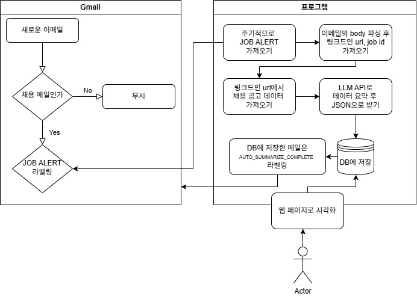
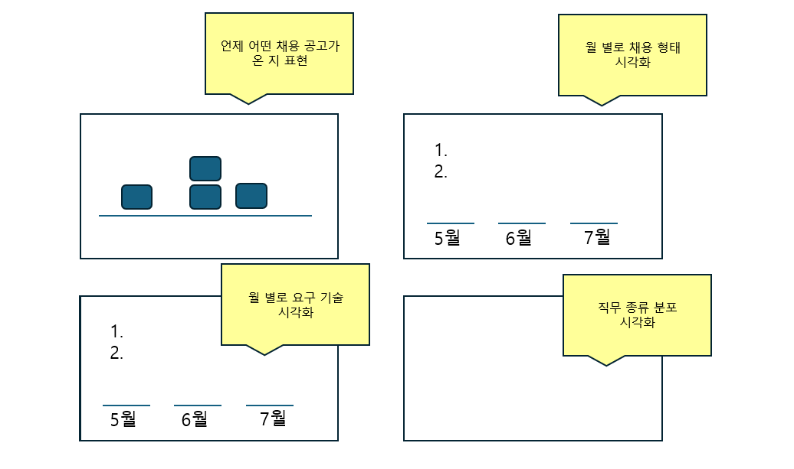

# 프로젝트 개요
### 시작하게  된 이유
> LinkedIn 사이트에 관심 직종을 등록하면 관련된 분야에서 구인구직 공고가 올라올 때 메일이 온다. 
>
> 메일의 <body>에는 해당 직무 공고 LinkedIn url 정보가 담겨있고 url을 타고 가져온 데이터에는 직무에서 요구하는 조건, 채용 조건, 채용 내용 등 양질의 정보가 담겨있다.
>
> 하지만 매번 이 메일의 내용을 확인하는 것도 번거롭고 이 데이터들을 DB에 저장하면 field의 경향을 파악하는 데 도움이 될 것이다.
>
> 본 프로젝트는 로컬 LLM을 사용하여 가져온 채용 정보들을 정량화하고 축적하여 구직 시장의 동향을 파악하는 데 도움을 주기 위함이다.


### 프로젝트 내용
> 본 프로젝트는 링크드인에 등록해 둔 관심분야의 채용 시장의 흐름을 파악하는 데 도움을 주기 위한 프로젝트이다.
>
> 따라서 다음과 같은 정보를 시각화하여 사용자에게 제공하는 것을 목표로 한다.
>
> 1\. 언제 어떤 메일이 왔는지 확인 <br>
> 2\. 월 별 채용 형태 랭킹 (직무, 정규/파트 타임/신입/인턴 등, 요구되는 경력)<br>
> 3\. 월 별 요구 기술 랭킹 (최소 요구 기술, 권장 기술)<br>
> 4\. 직무 종류에 따른 분포와 그에 요구되는 책임 (soft-skill 포함) 

<br><br>

# 프로젝트 구조

### 프로젝트 workflow 


### UI 구상

<br><br>

**제공하는 정보**
1. 시장 동향 분석
    - 기간별 채용 공고 증가/감소
    - 산업/직무별 채용 비중
    - 기업별 채용 활동 변화
    - 신설되거나 최근 증가하는 직무

2. 기술/역량 트렌드
    - Top 10 스킬(필수/우대)
    - 기술별 빈도 변화
    - 기술별 함께 요구되는 기술 조합

3. 직무별 요구 역량 분석
    - 직무별 주요 업무
    - 직무별 필수 역량
    - 요구 경력/학력
    - 직무 간 공통 역량/차이점

4. 기업별 채용 분석
    - 기업별 채용 직무
    - 채용 빈도 변화

# 실행 방법

**server side**

``` uv run python -m mail_auto_summrizor.main ```

**client side**

<br><br>