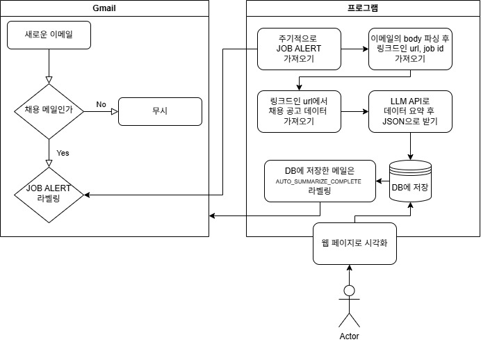

# 프로젝트 개요
### 시작하게  된 이유
> LinkedIn 사이트에 관심 직종을 등록하면 관련된 분야에서 구인구직 공고가 올라올 때 메일이 온다. 
>
> 메일의 <body>에는 해당 직무 공고 LinkedIn url 정보가 담겨있고 url을 타고 가져온 데이터에는 직무에서 요구하는 조건, 채용 조건, 채용 내용 등 양질의 정보가 담겨있다.
>
> 하지만 매번 이 메일의 내용을 확인하는 것도 번거롭고 이 데이터들을 DB에 저장하면 field의 경향을 파악하는 데 도움이 될 것이다.
>
> 본 프로젝트는 로컬 LLM을 사용하여 가져온 채용 정보들을 정량화하고 축적하여 구직 시장의 동향을 파악하는 데 도움을 주기 위함이다.
<br>

### 필요한 직무 정보
- 회사
- 직무 내용
- 요구 기술 스택
- 채용 형태(정규/비정규/인턴)
- 학위 조건, 경력 조건
- 인재상
<br><br>

# 프로젝트 구성도



### 실행 방법

``` uv run python -m mail_auto_summrizor.main ```
<br>

# DB 저장 테이블 형식

table을 따로 둬서 관리하게 하기

```
metadata
├── id
├── job id
└── processed date

job data
├── job id
├── url
├── company (회사명)
├── job title (직책)
├── responsibilities (담당 업무)
├── experience requirements (학위/경력 조건)
├── required skiils (최소 기술 역량)
├── preferred skiils (가산점 기술 역량)
├── soft skills (협업, 문제 해결 역량)
└── employment type (고용 형태)
```